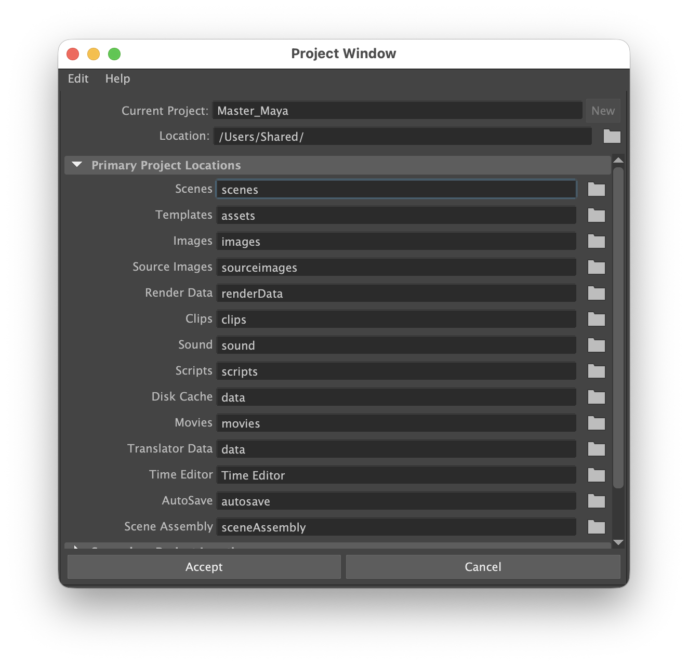
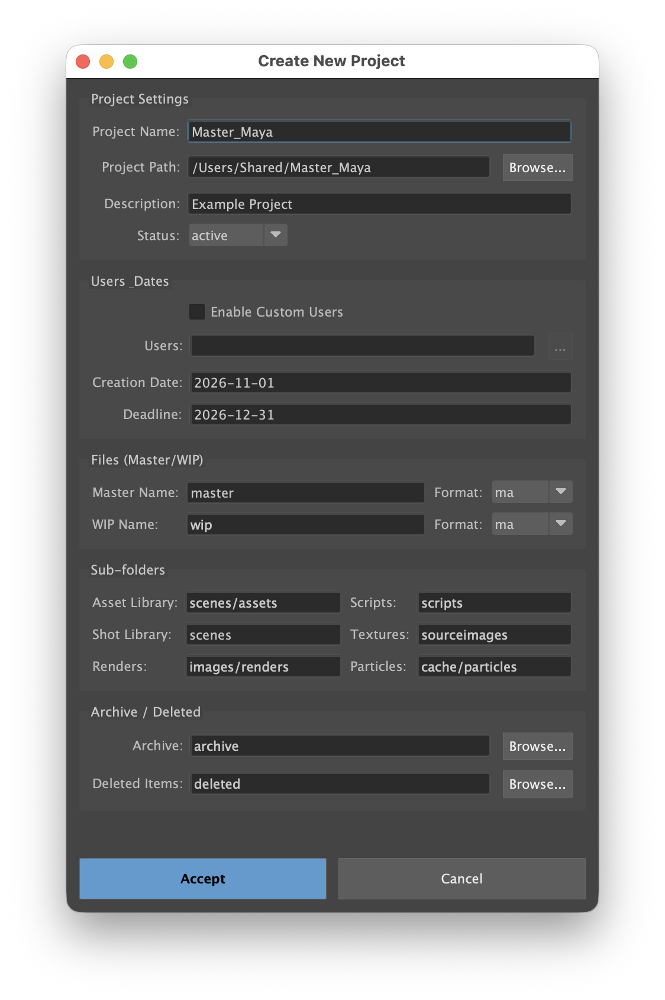

Maya Setup and Getting Started
==============================

This guide covers installing the current openPypeline Studio Maya integration and creating an initial project. For tested Maya and Python versions, see the requirements in the `README <https://github.com/StephenAnimates/OpenPipeline/blob/master/README.md#-requirements>`_.

1. Download and install openPypeline Studio
-------------------------------------------

Before opening Maya, download ``openPypelineStudio.zip`` from the `GitHub nightly releases <https://github.com/StephenAnimates/OpenPipeline/releases>`_ and extract it into your Maya scripts directory.
The extracted archive creates an ``openPypelineStudio`` folder. If you decide to clone the repository instead, name the checkout folder ``openPypelineStudio``.

Typical Maya script locations are:

* **macOS:** ``~/maya/scripts/`` or ``/Users/Shared/Autodesk/maya/scripts``
* **Windows:** ``%USERPROFILE%\maya\scripts\`` or ``C:\Users\YourName\maya\scripts``

2. Open Maya and set up a new or select an existing project directory
---------------------------------------------------------------------

A. After the folder is in the proper Maya script location, open Maya.
B. Create a new Maya project or set an existing one as the current workspace. The Maya project directory can be anywhere on your computer, but for a shared project, it should be in a cloud-synchronized folder or a working copy managed by `Apache Subversion (SVN) <https://subversion.apache.org/>`_, a centralized version-control system.

.. attention::

   The Maya project directory is the folder Maya uses as its current project/workspace. OpenPypeline Studio uses that same folder as its project root and adds its settings, manifest, and configured pipeline folders there.

* If a Maya project directory already exists:
   In Maya's main User Interface (UI), choose :menuselection:`File` > :menuselection:`Set Project` and select the existing Maya project directory. This will be the directory with the workspace.mel file and the project folders, such as ``scenes``, ``sourceimages``, and ``images``). Confirm that Maya's current project/workspace points to the intended directory.
* If a Maya project directory does not exist yet:
   In Maya's main User Interface (UI), choose :menuselection:`File` > :menuselection:`Project Window`, click the :guilabel:`New` button, name the new project, and set its location.

   The Maya New Project window.

For detailed step-by-step instructions, see :doc:`maya_project_setup`.

3. Run the openPypeline Studio setup script in Maya
---------------------------------------------------

A. Open the **Script Editor** window (:menuselection:`Windows` > :menuselection:`General Editors` > :menuselection:`Script Editor`).
B. Open a new Python tab (:menuselection:`Tabs` > :menuselection:`New Tab` then choose **Python** from the :guilabel:`Source Type` window)
C. Copy the following setup python code.

.. code-block:: python

   import sys

   # macOS example - the path to the directory containing the downloaded openpypeline package
   ops_install_path = "/Users/Shared/Autodesk/maya/scripts/openPypelineStudio"

   # Windows example - the path to the directory containing the downloaded openpypeline
   # package (uncomment the line below and comment out the macOS example above)
   # ops_install_path = r"C:\Users\YourName\maya\scripts\openPypelineStudio"

   if ops_install_path not in sys.path:
       sys.path.insert(0, ops_install_path)

   from openpypeline.app.maya.core import ops_loader
   ops_loader.openPypelineSetup()

D. Change the path in the code for your operating system and replace it with your actual install location. The path must point to the directory containing the downloaded ``openpypeline`` package.
E. Execute the code (:menuselection:`Command` > :menuselection:`Execute` or press :kbd:`Ctrl` + :kbd:`Enter` on Windows or :kbd:`Cmd` + :kbd:`Enter` on macOS).

.. tip::

   On Windows, always prefix your path with an ``r`` (e.g., ``r"C:\Users\..."``) or use forward slashes (``"C:/Users/..."``) so Python does not misinterpret backslashes as escape characters.

This will add the openPypeline package to your Python path and open the **openPypeline Studio Setup** window.

* **Default configuration:** The project file path is prefilled with the default location. For standard installations, simply click :guilabel:`Accept` to complete setup and launch the main openPypeline Studio UI.
* **Advanced customization:** If you need to customize where the project registry (``openpypeline_projects.json``) is stored:
  - Click the :guilabel:`Edit` button to unlock the field.
  - Click the :guilabel:`Browse...` button to choose a custom directory.
  - Click the :guilabel:`Default` button at any time to restore the prefilled default path.

F. Click the :guilabel:`Accept` button to save the configuration and launch openPypeline Studio.
G. Close the **Script Editor** window.

4. Create or join your first openPypeline Studio project in Maya
-----------------------------------------------------------------

Creating a Maya project directory and setting up an openPypeline project are coordinated actions: Maya's :guilabel:`Project Window` or :menuselection:`File` > :menuselection:`Set Project` defines the current workspace, while openPypeline registers and configures that directory with project settings and pipeline folders.

When openPypeline Studio launches, it checks the local project registry. If no projects are registered yet, it automatically prompts you to choose your initial project setup:

* **Create New Project:** Select this to configure your current Maya workspace as a new openPypeline project.
* **Join Existing Project:** Select this if a teammate has already configured the project and you are connecting your local synchronized copy or version control checkout.

A. Create a New Project
~~~~~~~~~~~~~~~~~~~~

If you choose **Create New Project** (or navigate to :menuselection:`Project` > :menuselection:`Project Manager...` > :menuselection:`New...`), the project creation dialog opens:

   The openPypeline Studio Create New Project dialog.

The dialog initially populates the project path from Maya's current workspace:

* **Project name and path:** Project names are limited to 22 characters. The dialog converts spaces to underscores and filters unsupported characters. By default, this matches the Maya project name, but you can change it. The project path defaults to Maya's current workspace and cannot be edited directly; use :guilabel:`Override...` only if you intentionally want openPypeline to use a different folder.
* **Description and status:** Mark the project active to make it available in the main project selector, or inactive to keep it out of that selector.
* **WIP and Master naming and formats:** Set the folder/file naming terms and choose from the formats currently offered by the Maya dialog (such as ``.ma``, ``.mb``, or ``.usd``).
* **Project folders:** Set the asset library, shot scenes, scripts, textures, renders, particles, archive, and deleted-item folders.
* **Optional project details:** Set dates and configure custom users if needed.

.. warning::

   Using :guilabel:`Override...` changes openPypeline's target directory without changing Maya's active workspace. To ensure relative file paths, textures, and references resolve cleanly, it is strongly recommended to keep openPypeline's project root matched to Maya's current workspace directory.

Review the project name and folder paths, then click :guilabel:`Accept`. openPypeline writes its project manifest (``.openpypeline/project.json``), creates the configured pipeline folders, and automatically activates the project in the main UI.

B. Join an Existing Project
~~~~~~~~~~~~~~~~~~~~~~~~

If a teammate has already created the project:

1. In the first-time prompt (or via :menuselection:`Project` > :menuselection:`Project Manager...` > :menuselection:`Join Existing...`), select **Join Existing Project**.
2. Browse to and select the local folder containing ``.openpypeline/project.json``.
3. openPypeline adds the project to your local registry and activates it without recreating or overwriting existing project folders.

.. important::

   **Do not synchronize your local registry:** Never share or cloud-sync your local ``openpypeline_projects.json`` file or your Maya scripts directory. Only share the actual project folder that contains the ``.openpypeline/project.json`` manifest.

5. Launch openPypeline Studio daily
-----------------------------------

Once installed and configured, you do not need to run the setup script again. Launch the main UI at any time by running:

.. code-block:: python

   from openpypeline.app.maya.core import ops_loader
   ops_loader.openPypeline()

.. tip::

   Highlight the snippet above in Maya's Script Editor and drag it with the middle mouse button to any Maya shelf tab to create a convenient quick-launch button!

6. Share a project with other artists
--------------------------------------

Each artist should install openPypeline Studio and configure its script and project-registry locations on their own computer. Do not share or synchronize the Maya scripts installation or the local ``openpypeline_projects.json`` file registry.

For a shared project, keep the Maya project folder in the team's synchronized cloud-drive location, Perforce (Helix Core) workspace, or SVN working copy. With Perforce or SVN, use the checkout root if the repository is dedicated to this project; otherwise, use the same project subfolder from the repository on every artist's computer.

1. The first artist sets or creates the Maya project in that shared location, then uses :menuselection:`Project Manager...` > :menuselection:`New...` to configure it for openPypeline. See :doc:`maya_project_setup` for the detailed steps.
2. Wait for cloud synchronization to finish or commit the new files, including ``.openpypeline/project.json``, to SVN.
3. Each other artist synchronizes or checks out the same project folder, sets Maya's current project to their local copy, and chooses :menuselection:`Project Manager...` > :menuselection:`Join Existing...`. Select the local folder containing ``.openpypeline/project.json``.
4. Joining adds the project to that artist's local registry without recreating or overwriting shared project folders. Active projects appear in the main project selector; inactive projects remain registered but are not selectable.

The shared manifest stores project settings, not an absolute machine-specific path, so each artist's local registry can point to their own synchronized folder or SVN working copy.

.. note::

   openPypeline's file notices are **advisory**, warning you when another artist has a scene open. Cloud synchronization services (Dropbox, OneDrive, Google Drive) update files asynchronously and cannot enforce real-time distributed locking. Always confirm sync status before modifying shared files.

Custom project icons
--------------------

To customize the image displayed for a project in the main openPypeline Studio UI, place an image named ``openPypelineIcon.png`` in the root folder of that project.

.. tip::

   For best results, use a square PNG (such as 128x128 or 256x256 pixels) with a transparent background for the ``openPypelineIcon.png``.
